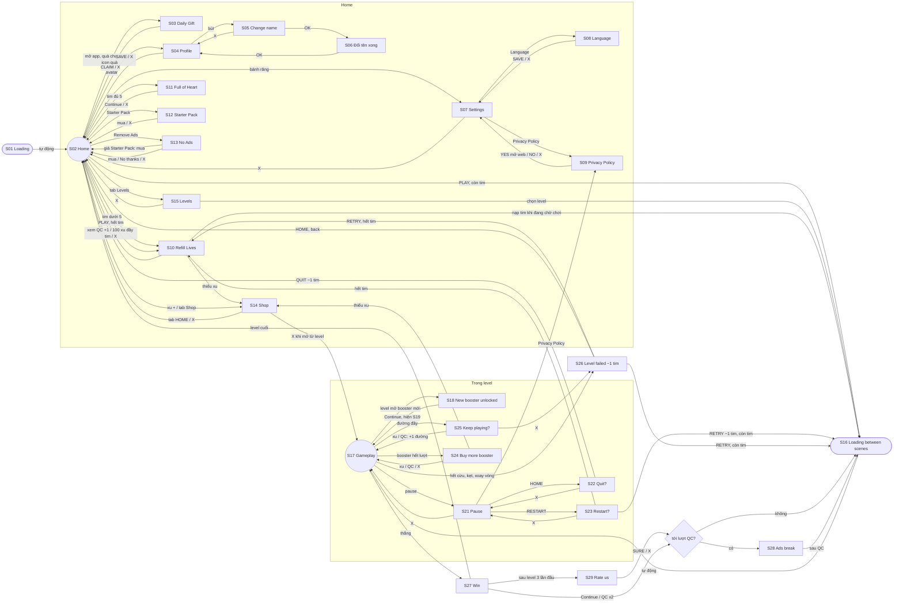

# Woolly Road: flow UX theo bộ UI Bus Dash

Nguồn: file Figma "Bus Dash", section **UI 1542:1124** (bản Bus Dash, 48 frame 886x1920). Section **UI 334:347** là bản cũ theme gỗ ("Color Loop"), chỉ dùng để đối chiếu. Figma không có liên kết prototype nào (`get_prototype_connections` trả 0), nên flow dưới đây được dựng từ nội dung các màn.

Quy ước:
- **Màn** là màn hình riêng.
- **Popup** nằm đè lên màn đang mở. Đóng popup (X, nút back Android) thì về đúng màn đã mở nó.
- Mọi màn đều có ít nhất một lối ra và đều đi tới được từ màn Loading.

## Danh sách màn

| # | Màn trong game | Frame Figma (1542:1124) | Loại | Trạng thái |
|---|---|---|---|---|
| S01 | Loading (splash) | loading 2072:2246 | màn | mới |
| S02 | Home | Main 3780:2931 / 3780:3018 / 3780:3029 | màn | có, thêm lối vào |
| S03 | Daily Gift | popup 4902:2802, 4930:2982… | popup | mới |
| S04 | Profile | Profile 1785:2033, 1792:2224 | popup | mới |
| S05 | Change name | change name 1792:2436 | popup | mới |
| S06 | Đổi tên thành công | notify 1792:2479 | popup | mới |
| S07 | Settings | setting 1529:1535 | popup | có, sửa link |
| S08 | Language | Language 1550:4384 | popup | mới (English / Tiếng Việt) |
| S09 | Privacy Policy | privacy policy 1785:1631 | popup | mới |
| S10 | Refill Lives | refill lives 1550:4752 | popup | mới |
| S11 | Full of Heart | full heart 1792:2534 | popup | mới |
| S12 | Starter Pack | popup_starterpack 2252:2149 | popup | mới |
| S13 | No Ads | popup_noads 1792:2505 | popup | mới |
| S14 | Shop | Shop 1550:5879 | màn | mới (trước là toast "coming soon") |
| S15 | Levels | (không có trong Figma, giữ của game) | popup | có |
| S16 | Loading between scenes | loading between scene 1550:6505 | màn chuyển | mới |
| S17 | Gameplay | Gameplay 1521:1061, 1550:1257 (Hard), 1550:1644 (Super hard) | màn | có, thêm Hard level |
| S18 | New booster unlocked | unlock booster 1550:4576… | màn | mới |
| S19 | Booster description | Gameplay 4029:2746 (thẻ dưới) | thẻ trong màn | mới |
| S20 | Hard level | Gameplay 1550:1257 | banner | mới |
| S21 | Pause | pause 1785:1920 | popup | có, Watch Ads có thưởng |
| S22 | Quit? (mất 1 tim) | refill lives 1582:7357 | popup | mới |
| S23 | Restart? (mất 1 tim) | refill lives 2 1792:2585 | popup | mới |
| S24 | Buy more booster / Add slot | buy more booster 1792:2863, add slot 1792:2925 | popup | có, theo Figma |
| S25 | Keep playing? | pre lose 1578:6714, almost there 1582:6786 | popup | có |
| S26 | Level failed | lose 1550:5985, refill lives 1582:6824 | màn | có, thêm −1 tim |
| S27 | Win | win 1550:5327, 1632:1456 | màn | có |
| S28 | Ads break | win 1582:6864 | màn | mới |
| S29 | Rate us | rate us 1785:1681 | popup | mới |

Chưa áp dụng (LiveOps cần nội dung riêng, để giai đoạn sau): **Winstreak** 2949:2251, **Daily Mission** 3208:2499.

## Sơ đồ

## Bảng đường nối

S09 Privacy Policy và S14 Shop là popup "quay lại nơi đã mở". Khi mở từ Pause hay từ trong level, đóng lại sẽ về Pause hay level.

| Từ | Hành động | Tới | Ghi chú |
|---|---|---|---|
| S01 | tải xong | S02 | splash tối thiểu 0,8 giây |
| S02 | lần đầu về Home mỗi ngày, quà chưa nhận | S03 | tự mở |
| S02 | icon quà (chấm đỏ khi chưa nhận) | S03 | |
| S02 | avatar | S04 | |
| S02 | ô tim | S10 hoặc S11 | S10 khi dưới 5 tim, S11 khi đủ |
| S02 | dấu + ở ô xu, tab Shop | S14 | |
| S02 | bánh răng | S07 | |
| S02 | icon Starter Pack | S12 | |
| S02 | icon Remove Ads | S13 | ẩn khi đã mua |
| S02 | tab Levels | S15 | |
| S02 | PLAY | S16 rồi S17 | hết tim thì mở S10 và nhớ level đang chờ |
| S03 | CLAIM | S02 | thưởng ngày hôm nay (xu hoặc booster) |
| S03 | X | S02 | |
| S04 | chọn avatar hay khung, SAVE | S02 | khung khóa: 100 xu, thiếu xu thì mở S14 |
| S04 | bút | S05 | |
| S05 | OK, tên hợp lệ | S06 | tên sai: báo lỗi ngay trong popup |
| S05 | X | S04 | |
| S06 | OK | S04 | |
| S07 | Language | S08 | |
| S07 | Contact | app mail | `Horus.support.mail` |
| S07 | Restore Purchase | thông báo kết quả | |
| S07 | Privacy Policy | S09 | |
| S07 | Privacy settings | màn consent của app | chỉ hiện khi `Horus.ads.has_privacy` |
| S07 | X | S02 | |
| S08 | SAVE | S07 | đổi ngôn ngữ ngay |
| S08 | X | S07 | |
| S09 | YES | trình duyệt, rồi S07 / S21 | |
| S09 | NO / X | S07 / S21 | |
| S10 | Watch Ads | +1 tim | đang chờ chơi thì vào S16 |
| S10 | 100 xu | đầy tim | thiếu xu thì mở S14 |
| S10 | X | màn trước (từ S26 thì về lại S26, ở đó có HOME), hoặc S02 nếu đến từ S23 | |
| S11 | Continue / X | S02 | |
| S12 | giá | mua, rồi S02 | |
| S12 | X | màn trước | |
| S13 | Remove Ads | mua, rồi S02 | |
| S13 | nút giá trên thẻ Starter Pack | mua Starter Pack, rồi S02 | giống thẻ "Remove Ads Bundle" của Figma: nút giá, không có "See offer" |
| S13 | No thanks / X | S02 | |
| S14 | mua / xem QC / booster bằng xu | ở lại S14 | |
| S14 | tab HOME / X | S02, hoặc màn trước nếu mở từ level | |
| S15 | chọn level đã mở | S16 rồi S17 | hết tim thì S10 |
| S15 | X | S02 | |
| S16 | tự động | S17 | |
| S17 | vào level mở booster lần đầu | S18 | |
| S17 | level khó | banner S20 | không chặn |
| S17 | nút pause / back | S21 | |
| S17 | booster có khóa | thông báo "Unlocks at Level N" | |
| S17 | booster hết lượt | S24 | |
| S17 | đường đầy, chưa dùng hết 2 lần cứu | S25 | |
| S17 | kẹt / hết cừu / xoay vòng | S26 | |
| S17 | thắng | S27 | |
| S18 | Continue | S17, kèm thẻ S19 | |
| S21 | X / back | S17 | |
| S21 | HOME | S22 | |
| S21 | RESTART | S23 | |
| S21 | Watch Ads | +25 xu, ở lại | |
| S21 | Restore / Privacy | thông báo / S09 | |
| S22 | QUIT | −1 tim, S02 | |
| S22 | X | S21 | |
| S23 | RETRY | −1 tim, rồi S16 nếu còn tim, S10 nếu hết | |
| S23 | X | S21 | |
| S24 | xu | +1 booster, S17 | thiếu xu thì S14 |
| S24 | Watch Ads | +1 booster, S17 | |
| S24 | X | S17 | |
| S25 | xu hoặc booster +1 Road | S17 | |
| S25 | Watch Ads | S17 | |
| S25 | thẻ Starter Pack | mua | |
| S25 | X | S26 | |
| S26 | RETRY | S16 nếu còn tim, S10 nếu hết | |
| S26 | HOME (nút cạnh RETRY) / back | S02 | khi hết tim đây là lối ra, RETRY chỉ mở S10 |
| S27 | Continue | (S29) → (S28) → S16 | level cuối: S02 |
| S27 | QC x2 | như Continue | |
| S28 | QC xong | S16 | |
| S29 | SURE | `Horus.review()` khi chọn từ 4 sao, rồi đi tiếp | |
| S29 | X | đi tiếp | |
